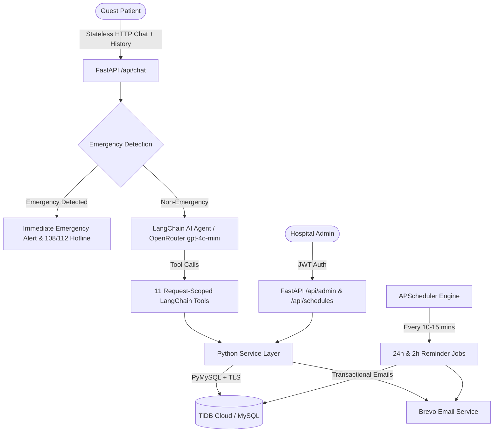

# MediDesk Agent – AI-Powered Hospital Appointment Booking System

MediDesk Agent is an end-to-end, production-grade, locally runnable backend application designed for hospital appointment management. It features a multilingual AI front-desk conversational assistant that enables patients to discover doctors, check slot availability, book appointments, cancel, and reschedule through a single conversational interface in **English, Telugu (తెలుగు), Hindi (हिन्दी), and Transliterated/Romanized scripts**.

The system is built on a **Zero-Login Guest Patient Experience**:
- Patients **never** register, create accounts, or log in.
- The chat is **completely stateless**: the frontend maintains conversation history in client state (e.g., React state), and the backend does not persist chat messages or maintain backend session tokens.
- Identity, email ownership, and booking confirmations are verified strictly through cryptographically secure **Email OTPs** sent via the Brevo Transactional Email API.
- Direct booking bypass has been completely eliminated: no appointment can be created without passing through OTP verification on a temporary booking request.

---

## 1. System Architecture



---

## 2. Technology Stack

| Layer | Technology | Purpose |
|---|---|---|
| **Language** | Python 3.11+ | Core programming language |
| **Backend Framework** | FastAPI | High-performance asynchronous REST API |
| **ORM** | SQLAlchemy 2.0 | Database abstraction, relationships, and queries |
| **Database** | TiDB Cloud (MySQL compatible) | Distributed relational database with TLS certificate verification |
| **Driver** | PyMySQL + certifi | Pure-Python MySQL driver with verified TLS |
| **Validation** | Pydantic V2 | Request/response data validation and settings management |
| **AI Framework** | LangChain Core / LangChain | Tool calling, message formatting, and prompt engineering |
| **LLM Integration** | langchain-openai | OpenRouter client interfacing |
| **AI Model & Provider**| OpenRouter (`openai/gpt-4o-mini`) | Cost-effective, high-accuracy conversational intelligence |
| **Email Service** | Brevo Transactional Email API | Delivery of booking confirmations, OTP codes, and reminders |
| **Authentication** | JWT (`python-jose`) + bcrypt | Secure admin authentication (Admin only) |
| **Scheduler** | APScheduler | Automated background appointment reminder execution |
| **Testing** | pytest & pytest-asyncio | 40 automated test cases covering 100% of workflows |

---

## 3. Database Schema Design (13 Tables)

The database schema is defined in SQLAlchemy ORM and provisioned on TiDB Cloud:

1. **`admin_users`**: Admin credentials with hashed passwords (`bcrypt`), role status, and audit linkages.
2. **`patients`**: Contact records matched by normalized email (`normalized_email`), phone, and full name. No passwords.
3. **`specialties`**: Hospital departments (Cardiology, Neurology, Orthopedics, Pediatrics, Dermatology, General Medicine, Gynecology).
4. **`doctors`**: Doctor profile information, qualifications, consultation fees, and spoken languages.
5. **`doctor_schedules`**: Recurring weekly working hours (weekday 0–6, start time, end time, slot duration).
6. **`doctor_schedule_exceptions`**: Doctor leaves, national holidays, and modified working hours.
7. **`doctor_slots`**: Individual appointment slots with status (`available`, `booked`, `blocked`). Unique constraint on `(doctor_id, start_time)`.
8. **`booking_requests`**: Temporary booking request records with unguessable references (`BREQ-XXXXXX`), validated details, and status (`pending_otp`, `verified`, `completed`, `expired`).
9. **`appointments`**: Bookings containing unique references (e.g. `MED-2026-XXXXX`), status, reason, and links to patient, doctor, and slot.
10. **`appointment_history`**: Audit trail of every booking, rescheduling, and cancellation with `changed_by` attribution.
11. **`otp_verifications`**: Cryptographically salted SHA-256 OTP hashes, booking request reference linkages, expiration timestamps, and failed attempt counters.
12. **`notifications`**: Delivery audit logs for all outgoing transactional emails.
13. **`human_handoffs`**: Patient requests for hospital front-desk staff assistance.

---

## 4. Key Business Logic & Engineering Highlights

### 4.1 Zero-Login Guest Patient Experience & Stateless Chat
- Patients **never** create accounts, usernames, or passwords.
- Anyone can open the chat and immediately converse as a guest.
- The chat endpoint (`POST /api/chat`) accepts `{"message": str, "history": [{"role": str, "content": str}]}`.
- History is maintained on the client (e.g., in React state), freeing the database from cross-request chat session locking.

### 4.2 Mandatory Email OTP Before Booking & No Direct Booking Bypass
No appointment can be reserved without verified proof of email ownership:
1. Patient selects a doctor and slot, and provides Name, Phone, and Email.
2. Agent/API calls `initiate_booking` (`POST /api/appointments/initiate`): validates slot availability, generates a temporary `booking_requests` record with reference `BREQ-XXXXXX`, and sends a 6-digit OTP to the patient's email.
3. Patient provides the 6-digit OTP.
4. Backend verifies the OTP (`POST /api/appointments/verify-otp`), marking the `booking_requests` record as `verified` and issuing a signed authorization token.
5. `confirm_booking` (`POST /api/appointments/confirm`): strictly validates that the booking request is `verified`, checks slot availability again, atomically reserves the slot, generates a unique booking reference (`MED-2026-XXXXX`), records audit history, commits the transaction, and sends an HTML confirmation email.
6. The old direct booking endpoint has been completely removed to prevent any possibility of bypassing OTP verification.

### 4.3 4 Dedicated OTP Purposes
The OTP verification engine supports 4 distinct operations:
- `BOOKING`: Validates patient contact details and authorizes appointment finalization.
- `VIEW_APPOINTMENTS`: Authorizes passwordless lookup of all appointments registered under an email.
- `CANCEL`: Authorizes cancellation of a specific appointment reference.
- `RESCHEDULE`: Authorizes rescheduling of a specific appointment reference to a new slot.

### 4.4 Atomic Double-Booking Prevention
Slot reservations enforce strict atomicity through conditional SQL rowcount verification:
```sql
UPDATE doctor_slots
SET status = 'booked'
WHERE id = :slot_id AND status = 'available';
```
If the affected rowcount is 0, the transaction immediately rolls back and raises `HTTP 409 Conflict`, preventing race conditions when two patients simultaneously attempt to reserve the same slot.

### 4.5 Multilingual AI Agent
The single LangChain agent dynamically converses in:
- English
- Telugu (తెలుగు) & Telugu Transliteration (e.g., *"Naaku repu cardiologist appointment kavali"*)
- Hindi (हिन्दी) & Hindi Transliteration (e.g., *"Mujhe kal doctor se appointment chahiye"*)
- Code-switched mixed dialects

Doctor names, specialties, and appointment references are preserved without distortion.

### 4.6 Pre-LLM Emergency Detection
Incoming messages are scanned by regex pattern matchers for acute medical emergencies (chest pain, heart attack, heavy bleeding, stroke symptoms, respiratory distress) across English, Telugu, and Hindi before invoking OpenRouter. If an emergency is detected:
- The LLM is bypassed completely to eliminate latency and hallucinations.
- Immediate localized instructions directing the user to emergency services (`108 / 112`) are returned.

### 4.7 11 LangChain Tools
1. `find_doctors`: Search active doctors by specialty name.
2. `get_doctor_details`: Retrieve full profile for a doctor.
3. `get_available_slots`: Query real-time available future slots for a doctor on a specific date.
4. `initiate_booking`: Validate doctor/slot, create temporary booking request, and dispatch 6-digit booking OTP to email.
5. `request_appointment_otp`: Trigger OTP dispatch for BOOKING, VIEW_APPOINTMENTS, CANCEL, or RESCHEDULE.
6. `verify_appointment_otp`: Verify submitted 6-digit OTP code.
7. `confirm_booking`: Atomically finalize and reserve an appointment using the verified booking request reference.
8. `get_my_appointments`: Retrieve appointment details by reference code or verified email token.
9. `cancel_appointment`: Safely cancel appointment and release slot with verification token.
10. `reschedule_appointment`: Atomically release old slot and reserve new slot with verification token.
11. `request_human_handoff`: Escalate patient inquiry to hospital front desk staff.

---

## 5. Local Setup and Execution

### 5.1 Prerequisites
- Python 3.11+
- TiDB Cloud account (or local MySQL 8.0)
- OpenRouter API key

### 5.2 Virtual Environment Setup
```bash
# Clone or navigate to the repository
cd d:\medibookagent

# Create virtual environment
python -m venv venv

# Activate on Windows PowerShell
.\venv\Scripts\activate

# Install dependencies
pip install -r requirements.txt
```

### 5.3 Configure Environment Variables
Copy `.env.example` to `.env`:
```bash
cp .env.example .env
```
Configure your `.env`:
```env
# Database – TiDB Cloud / Local MySQL
DB_HOST=gateway01.ap-southeast-1.prod.alicloud.tidbcloud.com
DB_PORT=4000
DB_USER=24PCcrjs8ZsEomE.root
DB_PASSWORD=your_password
DB_NAME=medibook
DB_SSL_CA=

# OpenRouter
OPENROUTER_API_KEY=your_openrouter_api_key
OPENROUTER_MODEL=openai/gpt-4o-mini

# Brevo (Sendinblue)
BREVO_API_KEY=your_brevo_api_key
BREVO_SENDER_EMAIL=noreply@medidesk.hospital
BREVO_SENDER_NAME=MediDesk Hospital

# Admin Credentials
ADMIN_EMAIL=admin@medidesk.hospital
ADMIN_PASSWORD=AdminPassword123!

# JWT
JWT_SECRET=supersecretjwtkey_change_in_production_min_32_chars!
JWT_EXPIRE_MINUTES=60

# Application
HOSPITAL_TIMEZONE=Asia/Kolkata
EMERGENCY_NUMBER=108
FRONT_DESK_EMAIL=frontdesk@medidesk.hospital
```

### 5.4 Database Initialization & Seeding
Run the idempotent seed script to create all tables and populate initial admin, 7 specialties, 7 doctors, schedules, 336 appointment slots for the next 7 days, patients, and sample bookings:
```bash
python -m scripts.seed_data
```

### 5.5 Start the Server
```bash
uvicorn app.main:app --reload
```
- Interactive API Documentation (Swagger): [http://127.0.0.1:8000/docs](http://127.0.0.1:8000/docs)
- Alternative Documentation (ReDoc): [http://127.0.0.1:8000/redoc](http://127.0.0.1:8000/redoc)
- Health Check: [http://127.0.0.1:8000/health](http://127.0.0.1:8000/health)

---

## 6. Running the Automated Test Suite

The test suite runs **40 automated test cases** covering stateless chat, authentication, doctor management, schedule slot generation, double-booking prevention, concurrency, cryptographic OTP verification, email notifications, emergency detection, and full patient workflows:

```bash
pytest -v
```

---

## 7. Complete API Endpoint Reference

### Conversational AI Chat (Stateless)
- `POST /api/chat`: Send patient message and conversation history to AI front-desk agent.

### Guest Patient Appointments & OTP
- `POST /api/appointments/initiate`: Step 1 of booking: validate doctor and slot, create booking request, dispatch 6-digit email OTP.
- `POST /api/appointments/verify-otp`: Verify 6-digit OTP code and retrieve signed action authorization token.
- `POST /api/appointments/confirm`: Step 2 of booking: verify server-side OTP, atomically reserve slot, and create appointment.
- `POST /api/appointments/request-otp`: Request OTP for `BOOKING`, `VIEW_APPOINTMENTS`, `CANCEL`, or `RESCHEDULE`.
- `GET /api/appointments/verified`: Passwordless lookup of all appointments registered under an email (requires verified token).
- `POST /api/appointments/cancel`: Cancel appointment (requires verified OTP token).
- `POST /api/appointments/reschedule`: Reschedule appointment (requires verified OTP token).
- `GET /api/appointments/{reference}`: Retrieve appointment details by reference code (requires verified OTP token or Admin authorization).
- `GET /api/appointments`: List appointments with filters (Admin only).

### Authentication (Admin Only)
- `POST /api/auth/login`: Admin login returning JWT access token.
- `GET /api/auth/me`: Authenticated admin profile details.

### Specialties
- `GET /api/specialties`: List all active specialties.
- `GET /api/specialties/{id}`: Retrieve specialty by ID.
- `POST /api/specialties`: Create new specialty (Admin only).
- `PUT /api/specialties/{id}`: Update specialty (Admin only).
- `DELETE /api/specialties/{id}`: Deactivate specialty (Admin only).

### Doctors
- `GET /api/doctors`: List all active doctors.
- `GET /api/doctors/search?specialty=Cardiology`: Search active doctors by specialty name.
- `GET /api/doctors/{doctor_id}`: Retrieve doctor profile.
- `GET /api/doctors/{doctor_id}/slots?date=YYYY-MM-DD`: Available slots for a doctor on a specific date.
- `POST /api/doctors`: Create doctor (Admin only).
- `PUT /api/doctors/{doctor_id}`: Update doctor (Admin only).
- `DELETE /api/doctors/{doctor_id}`: Deactivate doctor (Admin only).

### Doctor Schedules & Slots
- `POST /api/schedules`: Add recurring weekly doctor schedule (Admin only).
- `GET /api/schedules/doctor/{doctor_id}`: View schedules for a doctor (Admin only).
- `PUT /api/schedules/{schedule_id}`: Update recurring schedule (Admin only).
- `DELETE /api/schedules/{schedule_id}`: Deactivate recurring schedule (Admin only).
- `POST /api/schedules/exceptions`: Add holiday, leave, or modified hours (Admin only).
- `POST /api/schedules/generate-slots`: Generate slots for a date range (Admin only).
- `POST /api/schedules/block-slot/{slot_id}`: Block an available slot (Admin only).

### Administration & Monitoring
- `GET /api/admin/stats`: Operational dashboard statistics (appointments, doctors, specialties).
- `GET /api/admin/appointments`: Detailed administrative appointment view.
- `GET /api/admin/notifications`: Outgoing email delivery audit log.
- `GET /api/admin/handoffs`: Human staff assistance requests.
- `POST /api/admin/appointments/{appointment_id}/no-show`: Mark appointment as no-show.
- `POST /api/admin/jobs/run-reminders`: Manually trigger 24-hour and 2-hour reminder jobs.
- `POST /api/admin/jobs/run-24h-reminders`: Manually trigger 24-hour reminder job.
- `POST /api/admin/jobs/run-2h-reminders`: Manually trigger 2-hour reminder job.

### System Health
- `GET /health`: Verify application and database status.
